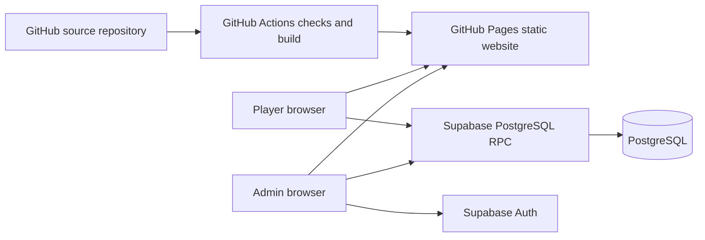

# Architecture and infrastructure

## Hosting decision

GitHub Pages is a static host: it publishes HTML, CSS, and JavaScript, not an application server. The requested website can stay on Pages while using an external backend. [GitHub Pages documentation](https://docs.github.com/en/pages/getting-started-with-github-pages/what-is-github-pages)

| Option | Administration | Answer visibility | Tradeoff |
| --- | --- | --- | --- |
| Selected: Pages + Supabase | In-app authenticated dashboard | Answers stay in backend storage | Requires an additional service and internet connectivity |
| Pages only | GitHub repository editor or Actions workflow | Published answers and future schedules can be inspected | No secure in-app admin or private answer checking |

The owner confirmed Pages + Supabase on 2026-11-20. The selected option preserves the requested admin experience. A password prompt in static JavaScript cannot authorize database changes securely. Do not put a GitHub token or privileged backend key into a browser to simulate administration.

Company branding is planned. Before deployment, check the final use against GitHub Pages usage restrictions, especially if the scope becomes paid SaaS or a transaction-focused business site. The current scope is a public game without commerce. [GitHub Pages limits](https://docs.github.com/en/pages/getting-started-with-github-pages/github-pages-limits)

## Components



- Frontend: React, TypeScript, Vite, CSS variables for branding. Installed versions are pinned in package-lock.json.
- Frontend navigation: hash routes (`#/play`, `#/p/<token>`, `#/admin`) so direct links work without Pages server rewrites.
- Backend: Supabase Auth and PostgreSQL. The authenticated `wordle_api` security-definer RPC checks roles, resolves puzzles, and processes guesses in database transactions. Private helpers have no client execution grants. No Edge Function deployment is needed.
- Database: migrations tracked in Git. Restrict table access with row-level security and explicit grants; public clients never read answers or admin roles. [Row-level security documentation](https://supabase.com/docs/guides/database/postgres/row-level-security)
- Browser storage: versioned progress cache, preferences, local statistics, and guest session; isolate by deployment namespace and puzzle ID.
- Assets: self-host licensed Persian font and logo, with fallbacks. No video uploads or media infrastructure needed.

## Identity and security

Players receive an anonymous authenticated session without an email form. Admins use Supabase authentication, preferably passwordless email, with an explicit server-managed administrator membership. The public app has no admin-enrollment mechanism. An authenticated user is not automatically an administrator.

Every administrative request checks the verified user and admin membership. Hiding navigation is only a UI choice. Reject unauthorized writes at the function and database boundaries. Never trust editable profile metadata for roles.

Use HTTPS, exact allowed origins and auth redirect URLs, input limits, per-session and practical IP abuse limits, and server-side six-attempt enforcement. CORS is not authentication. Do not log access tokens, answers, raw guesses, or recording-link tokens. Functions using privileged credentials must explicitly scope every operation and use narrowly defined transactional database functions.

Only the backend URL and publishable client key are public frontend configuration. Store privileged keys as backend/CI secrets when required; never under `VITE_*`, in a bundle, or in `context/`. Limit anonymous session creation abuse and monitor provider quotas. Backend row policies and function authorization need negative tests before deployment.

## Deployment pipeline

1. Create/select the owner's GitHub repository and protect the release branch where supported.
2. Scaffold and lock dependencies. Configure Vite `base` for `/<repository>/`, or `/` for an account site/custom root domain.
3. Pull requests run dependency install, type checks, core tests, and production build. Add targeted browser checks after the game is functional.
4. Apply reviewed database migrations containing compatible backend functions before deploying a frontend that requires them. Keep an explicit manual backend deployment checklist initially.
5. Pushes to the release branch run checks, build `dist/`, upload the Pages artifact, and deploy through a GitHub Pages environment with minimum permissions.
6. Use Pages Actions deployment permissions (`contents: read`, `pages: write`, `id-token: write`), a deployment concurrency group, and pinned reviewed action revisions at implementation time.
7. Verify real mobile play, direct puzzle/admin links, auth callback handling, and project-subpath assets against the published URL.

GitHub supports custom Actions deployment workflows. Vite documents the Pages base path and static deployment setup. [GitHub workflow documentation](https://docs.github.com/en/pages/getting-started-with-github-pages/using-custom-workflows-with-github-pages), [Vite deployment guide](https://vite.dev/guide/static-deploy.html)

## Environments and operations

Development uses a local Vite server and a development backend; never seed it with production recording puzzles. Use isolated staging data/backend configuration before production testing. Keep production backend secrets separate from development and preview builds.

No daily redeploy or midnight CI job is required: the backend resolves the Tehran date and atomically creates the day's puzzle if necessary. Pre-scheduled puzzles take precedence. If there is no eligible fallback word, return a clear unavailable state and alert the admin; do not pick separately in each browser.

On backend failure, show a retryable message and preserve local state; do not fall back to a different offline answer. Submission retries use an idempotency key. On frontend rollback, redeploy the previous known-good artifact. Database rollback needs a tested restore/forward-fix procedure; frontend rollback alone cannot reverse a destructive migration.

Before launch, establish database export/backup procedures, restore instructions, failure monitoring, quota alerts, retention for anonymous sessions/attempts, and ownership of the accounts. Verify current service quotas, regional reachability for the intended audience, and applicable costs at provisioning; no paid tier or zero-cost guarantee is assumed. Load-test realistic traffic before a large video release. Keep all third-party integrations out of the critical path unless required.

## Planned repository layout

```text
context/                  Requirements, decisions, status, handoff
src/app/                  Routes and application shell
src/game/                 Pure normalization and scoring logic
src/components/           Board, keyboard, dialogs, recording view
src/features/admin/       Authenticated puzzle management
src/lib/                  API client, storage, configuration
src/branding/             Company configuration and theme
public/                   Licensed fonts, logos, static assets
data/                     Dictionary provenance and approved seed inputs
supabase/migrations/      Schema, policies, transactional functions
supabase/functions/       Player and admin request handlers
tests/                    Core, authorization, and browser coverage
.github/workflows/        Validation and Pages deployment
```

The source, game engine, admin UI, tests, SQL migrations, and deployment workflows now exist. The implemented backend uses PostgreSQL RPC instead of Edge Functions. Private production puzzle data must never be committed as seeds.
